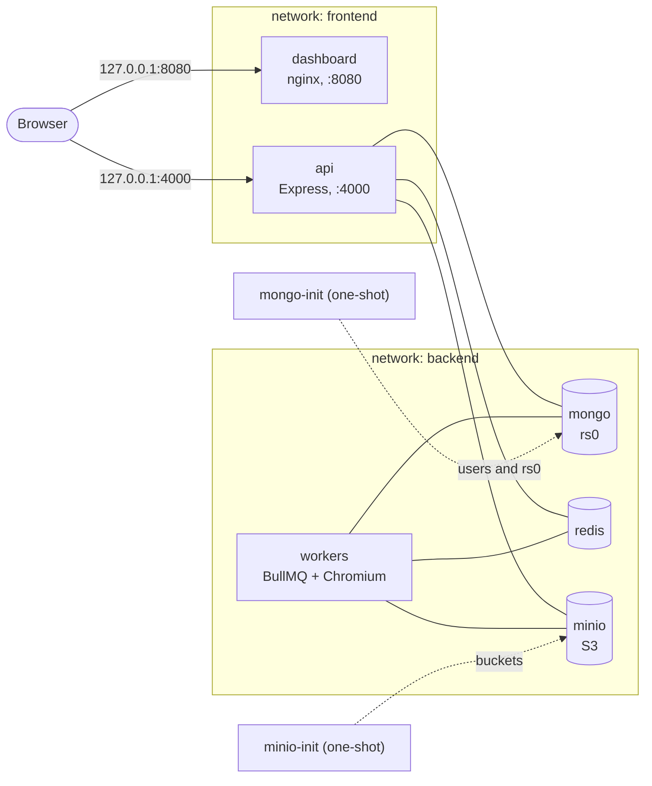

# Revamp

Revamp finds local businesses with dated websites, audits each site, builds a modern one-page MVP from the site's own content, and prepares a personalised outreach email. A human operator reviews everything in the dashboard. Nothing is sent until they approve it.

```
Maps search ─┐
             ├─► Audit ─► MVP page (model) ─► checks, publish + completeness ─► Operator review (HITL) ─► Email ─► Tracking
Manual URL ──┘
```

- **Discovery:** searches OpenStreetMap (no key needed) or Google Places by niche and city, pre-assesses each site (simple or not, redesign signs), and the operator picks which businesses become leads. "Search again, skip checked" repeats a search without the businesses it (and the searches before it) already offered, so the next batch is new ones.
- **Audit:** Playwright captures above-the-fold and full-page screenshots (cookie banners dismissed first), then runs axe-core (WCAG 2.1 AA, violations kept on the audit), measures LCP and CLS in the page (`webVitals`; no Lighthouse run), checks web standards and SEO (HTTPS, viewport, title, meta description, a single h1, favicon, Schema.org, OpenGraph) and runs a Vision LLM design critique. It also extracts the brand palette, logo, contacts and the site's own text. A site that cannot be audited (unresolvable domain, invalid certificate, repeated browser crashes) moves the lead to `AUDIT_FAILED` with a one-line reason; the operator can retry the audit or reject the lead.
- **MVP:** a model designs and writes the whole page (HTML and CSS) from what the audit verified: the business's name, niche, city and language, its services and main copy, brand colors, logo, images and the desktop screenshot. Contacts appear only as placeholders that code fills from verified data, the page may show only the original's own images, and facts the original site does not support are flagged for the operator to check (REV-136 – REV-140). Its `<head>` gets a meta description, OpenGraph tags and Schema.org `LocalBusiness` JSON-LD built by code from verified data. Every publish re-checks the page with the audit's standards checks and measures its LCP and CLS on the audit's phone profile, where it is hosted. The Before / After banner attached to the email shows only measured values: the original's LCP, accessibility issues and standards score, and the prototype's standards score (REV-126). The earlier section rebuild, modernized look and Bento templates were removed in REV-141; REV-142 documents the generator in full.
- **Dashboard:** a review-queue layout with an icon rail and client-side routes (`/` review queue: tabs for the Needs you, In progress, Outreach and Closed buckets with counts, a list of the bucket's leads next to the selected lead's review, quick filters by status and score band (Filter next to the list caption; they reset when the bucket changes), the next lead selected after an approve or reject while a lead a worker or a regeneration moves to another bucket stays selected, J / K / Enter to move and open, and an open-full-screen button in the selected lead's header; `/leads` all leads as a table or board filtered by bucket, niche and site type, `/leads/:id` a lead's review, `/leads/:id/preview` the lead's MVP full-window with the same Design tools (opened in a new tab from the Prototype step, with a link to the published page the lead receives), `/settings` theme, language and the default LLM), a lead review in three steps (1 Audit: original-site screenshots, metrics with a line on what each one means and which values are good, the MVP data check, flaws and quick wins; 2 Prototype: the sandboxed MVP with breakpoints, regeneration with a choice of LLM provider and model, and a Design tools panel floating over the preview (drag it by its handle or move it with the arrow keys, Home or reset position puts it back in the top-right corner, collapse it to its header; its place lasts for the browser session) holding a "Describe a change" field where the operator asks for a change in their own words (the model writes the page again without adding facts, and says why when nothing was published), the page's five colors with the original's brand colors offered first and the text contrast checked as they pick (AA on the background and the surface, or Apply stays off), a font pairing menu, the page's versions with Restore, and Regenerate; an MVP made by the previous generator offers Regenerate only. Every change re-publishes the page, so the page opened in a new tab and sent to the lead matches it, and the tools lock once the lead leaves review. Under the preview, facts the original site does not support are listed for the operator to check, each with "Show in preview" (a chip on the Prototype tab counts them), and "What changed" shows measured values only: standards, the original's accessibility issues, LCP and CLS of both pages with the prototype's host, and the business data kept (REV-140), then "Design changes": the page model's own list of what it changed against the original site and why, written in the dashboard language the lead was added in (Regenerate and a described change use the current one), kept per version so Restore shows that version's list, with a note when the operator's colors or fonts replace the model's, and absent when the model gave no valid list (REV-162); 3 Email: the email editor with an inbox preview) and a bottom action bar where Approve & send exists only on the email step and Reject on every step. Keyboard shortcuts (REV-47), listed in an overlay opened with `?` or the keyboard button on the rail: `1` / `2` / `3` go to the review queue, all leads and settings, `D` opens Find businesses, `N` Add lead, `/` focuses the lead search, J / K / Enter move through and open the queue, Esc closes a dialog or drawer, and ⌘ + Enter (Ctrl + Enter off macOS) approves on the email step through the Approve button's usual checks and confirmations. Shortcuts are off while typing in a field or working in a dialog, and plain shortcuts never fire with a modifier held, so browser shortcuts keep working. The elements show their keys (REV-97): a `/` key cap in the empty search field, and the key in the tooltips of the rail entries, Find businesses, Add lead and Approve & send. The UI is available in English, Russian, Belarusian, Polish and Lithuanian, with a Hyperliquid-inspired dark theme (the default target) and a matching light theme.

## Quick start

You need three things installed:

- [Node.js](https://nodejs.org) 20 or newer (`node -v` to check)
- [Docker Desktop](https://www.docker.com/products/docker-desktop), running (it provides MongoDB, Redis and MinIO)
- Git

Then, from the cloned folder:

```bash
npm run setup   # once: dependencies, Chromium, .env, databases, shared packages
npm run dev     # every time: starts everything, then open http://localhost:5173
```

`npm run setup` checks Node and Docker, runs `npm install`, downloads the Chromium build Playwright uses for site audits, creates `.env` from `.env.example` (an existing `.env` is never overwritten), starts MongoDB, Redis and MinIO in Docker and waits until they are healthy, sets up the MongoDB users (see [MongoDB users](#mongodb-users)), creates the MinIO buckets and builds the shared packages. It is safe to run again, for example after pulling changes that add dependencies.

`npm run dev` starts the Docker services if they are not running, rebuilds a shared package only when its sources changed, then runs the API, the workers and the dashboard in one terminal. Every line is tagged with the app it came from (`[api      ]`, `[workers  ]`, `[dashboard]`). If one app crashes the others stop too, so the error stays at the bottom of the output.

| Address | What |
|---|---|
| http://localhost:5173 | Dashboard |
| http://localhost:4000/api/v1 | API |
| http://localhost:9001 | MinIO console (`minioadmin` / `minioadmin`), where the generated MVPs are stored |

### Sign in

The dashboard and the API need an account (REV-206). Open http://localhost:5173/register to create a studio: you become its owner and are signed in at once. After `npm run db:seed` you can also sign in as the demo owner, `demo-owner@revamp-demo.test` with the password `demo-owner-password` (a local test account; the seed refuses any database that is not on this machine). Sessions are JWTs signed with `JWT_SECRET` (at least 32 characters; `npm run setup` and `npm run dev` generate it into `.env`, and the production preflight `npm run verify:env` checks it) and last 7 days. The API reads the token from `Authorization: Bearer <token>`; only `/health`, `/auth/register`, `/auth/login`, `GET /invitations/:token` and `POST /invitations/:token/join` (an invitation link, whose token is the secret), `/track/*` (email recipients and MVP pages) and `GET /mvp/preview/:slug` (loaded in an iframe) are public. Until the tenant split (REV-209) every signed-in user still sees the same leads. Registration is open, so on a deployment reachable from the internet anyone can create an account and then read all leads and approve outreach: keep such a deployment on a private network until REV-209 is merged. `deploy/deploy.sh` refuses to deploy while `JWT_SECRET` in `.env.production` is missing or shorter than 32 characters; add it on the server first.

### Roles and invitations

Every member of a studio has one role (REV-207). A **viewer** reads everything and changes nothing; an **operator** also adds leads, runs discovery and audits, generates and edits MVPs, and approves, rejects and test-sends email; an **owner** also manages the team. The API refuses a viewer's write with `403 FORBIDDEN` and a non-owner's team request the same way (a malformed id answers `400 INVALID_ID`), and the dashboard hides what the role cannot use. The role is read from the database on every request, so a role change or a removal applies at once.

An owner opens **Team** in the rail (owners only), types an address and a role, and gets a one-time link to send (the platform sends no invitation email). The invited person opens it, creates an account with **that address** or, if the account exists (also after being removed from the studio), enters its password, and joins the studio with the invited role. There is no email verification: whoever holds the link can register the invited address, so treat the link as a secret and send it privately. A link works once and expires after 7 days; creating a new invitation for the same address replaces the older one. The last owner of a studio cannot be removed or demoted. A person who belongs to two studios signs into the older one; there is no switcher yet.

Press **Ctrl+C** to stop the apps. The Docker containers keep running so the next start is fast; `npm run docker:down` stops them (your data stays in Docker volumes).

### Add an LLM provider

The app starts without one, but audits and MVP generation need an LLM, and nothing is faked when it is missing. Pick one:

- Put `ANTHROPIC_API_KEY` (or `OPENAI_API_KEY`) in `.env`, then restart `npm run dev`.
- Or install the [Claude Code CLI](https://docs.anthropic.com/en/docs/claude-code), log in (`claude`) and set `MVP_LLM_PROVIDER=claude-cli` in `.env`. It uses the account the CLI is logged into, so no API key is needed.

`npm run setup` ends by listing the providers it found and warns about anything still missing. [LLM providers](#llm-providers) covers every option. Discovery (OpenStreetMap) works with no key; sending email needs `EMAIL_PROVIDER` (see [Email](#email)).

### Troubleshooting

| Message | Fix |
|---|---|
| `Docker is installed but not running.` | Start Docker Desktop and wait until it reports it is running. |
| `Port 5173 (dashboard) is already in use.` (or 4000) | Another copy of the app is running, maybe in another terminal. Stop it, or find it with `lsof -i :5173`. |
| `docker compose up` fails with a port error | Another MongoDB (27017), Redis (6379) or MinIO (9000/9001) is running on your machine. Stop it, then run `npm run dev` again. |
| `The project is not set up yet.` | Run `npm run setup` first. |
| `MongoDB already has users, and MONGO_ROOT_PASSWORD in .env does not log in as revamp_root.` | Your MongoDB volume was set up with another `.env` (for example, `.env` was deleted). Put the old `MONGO_ROOT_PASSWORD` back, or start over with `docker compose down -v`, which deletes all local data. |
| `N lead(s) belong to no studio yet (REV-209)` at API or worker startup | Records predate the studios; no studio sees them until the migration ran. Run `npm run migrate:tenants --workspace=@revamp/api`, read the dry run (it names the organization that takes the leads: the oldest, or `-- --organization <id>`), then add `-- --apply`. |
| `N lead(s) have no shared business yet (REV-208)` at API or worker startup | Leads predate the shared business. Run `npm run migrate:businesses --workspace=@revamp/api`, read the dry run, then add `-- --apply`. |
| `leadId is not unique yet (REV-201)` at API or worker startup | The database predates the unique `leadId` index. Run `npm run migrate:unique-lead-children --workspace=@revamp/api`, read the dry run, then add `-- --apply`. |
| An audit fails at the design critique | No LLM provider is configured, see above. |

## Repository layout

```
apps/
  api/          Express REST API (/api/v1), BullMQ producers
  workers/      BullMQ workers: discovery, audit, AI page generation, deploy, MVP page changes, email
  dashboard/    Operator UI: React, Vite, MUI v6, TanStack Query, Zustand, i18next
packages/
  shared-types/ Types, enums, DTOs and queue names shared across the monorepo
  validation/   Zod schemas for HTTP payloads and LLM output
  db/           Mongoose models shared by the API and the workers
deploy/         Production Docker, Nginx and deploy script
.github/        GitHub Actions CI/CD workflow (gates on every PR, deploy from main)
scripts/        setup / dev launchers, maintenance and live-crawl scripts
```

## Local development

See [Quick start](#quick-start) to get the app running. The pieces behind `npm run setup` and `npm run dev`, if you want to run them yourself:

```bash
npm install
npx playwright install chromium
cp .env.example .env
npm run docker:up        # MongoDB :27017 (+ users), Redis :6379, MinIO :9000 (console :9001)
npm run build:packages   # the apps typecheck against the packages' compiled dist
npm run dev:api          # http://localhost:4000/api/v1
npm run dev:workers
npm run dev:dashboard    # http://localhost:5173
```

The `minio-init` container creates the `revamp-assets` and `revamp-demos` buckets. The API and workers read the root `.env`. Use `npm run docker:up` rather than plain `docker compose up`: only the former creates the MongoDB users and the replica set.

### MongoDB users

MongoDB runs with access control as a single-node replica set (`rs0`), so the app never connects as a superuser and can use transactions (REV-198). `npm run setup`, `npm run dev` and `npm run docker:up` generate the passwords into `.env` (existing values are kept), point the default `MONGODB_URI` at `revamp_app`, initiate the replica set and create or update these users in the `admin` database:

| User | Roles | Used by |
|---|---|---|
| `revamp_app` | `readWrite` on `revamp` | API, workers, migration and backfill scripts (`MONGODB_URI`) |
| `revamp_read` | `read` on `revamp` | Inspection and reporting |
| `revamp_admin` | `dbAdmin`, `userAdmin` on `revamp` | Index and user maintenance |
| `revamp_root` | `root` | Only to create the users above |

`readWrite` lets the app create indexes (Mongoose builds them at startup), but not drop the database or manage users. `npm run db:check-roles` logs in as each user and checks these rights against the running MongoDB.

The first `npm run dev` after this change upgrades an existing data volume in place: your data stays. The keyFile the replica set needs is generated inside the `mongo_config` volume and never leaves it. The apps log the MongoDB URI with the password replaced by `***`.

**Upgrading a shared dev stack.** That first start recreates the `revamp-mongo` container with access control. API and worker processes that were already running keep the old URI without a user and fail until you restart them. Another checkout or worktree that uses the same containers needs the `MONGODB_URI` and `MONGO_*_PASSWORD` lines from the `.env` that ran the upgrade, so copy them over. An `.env` without them would generate new passwords that the existing users don't have, and setup stops with the root-password message.

**Adding a lead is atomic (REV-202).** The lead and its first audit are inserted in one transaction, so a failed audit insert leaves no lead; this is why MongoDB must be a replica set (a standalone `mongod` answers every Add lead with "Transaction numbers are only allowed on a replica set member": run `npm run docker:up`). The audit job is queued after the commit with a 5 s limit. If Redis fails or does not answer, the lead moves to `AUDIT_FAILED` with the reason, the API answers `503 AUDIT_QUEUE_UNAVAILABLE`, and Retry audit recovers it; a discovery import stops creating leads at that point and reports the rest as failed. Leads stranded in `QUEUED` before this change are found by `npm run repair:queued-leads` (see [Scripts](#scripts)).

**Approving outreach is atomic (REV-203).** The lead's move to `SCHEDULED` and its approved campaign are written in one transaction, then the send is queued with a 5 s limit. If Redis fails or does not answer, both go back to `NEEDS_APPROVAL` (the approval stamps are cleared), the API answers `503 EMAIL_QUEUE_UNAVAILABLE`, and the operator approves again; nothing is sent, because the email worker only sends to a `SCHEDULED` lead. Leads stranded in `SCHEDULED` before this change are found by `npm run repair:scheduled-leads`.

**One business per site, one lead per studio (REV-208).** The company and its site are a shared `Business` (one per domain); a lead is one studio's pursuit of it. When another studio already audited the site, adding it gives your studio an `AUDITED` lead with that audit at once (and queues the MVP generation) instead of a second audit; adding a site your studio already has answers `409 LEAD_ALREADY_EXISTS`. Leads made before this have no business: the API and workers print a warning at startup until `npm run migrate:businesses --workspace=@revamp/api -- --apply` has run once (dry run by default; see [Scripts](#scripts)). **A studio sees only its own data (REV-209, REV-210).** Leads, MVPs, campaigns and events carry the studio's `tenantId`; every API read and write goes through one scope layer (`apps/api/src/data/tenant-scope.ts`), and another studio's record answers the same `404` as a missing one. The public tracking, unsubscribe and preview links take the studio from the secret they carry. Every queue job carries the studio and a worker refuses a job whose studio is not its lead's, writing nothing. Records made before the studios have none and are invisible until `npm run migrate:tenants --workspace=@revamp/api -- --apply` has run once; run it before starting the workers of this version, since jobs queued earlier fail and leave their leads in a working status: drain the audit, ai-generation, deploy and email queues (let them finish) before deploying.

**One MVP and one campaign per lead (REV-201).** `leadId` is unique on `mvpprojects` and `emailcampaigns`. A database created before this has a plain `leadId_1` index that Mongoose cannot turn unique, so the API and workers print a warning at startup until `npm run migrate:unique-lead-children --workspace=@revamp/api -- --apply` has run once (see [Scripts](#scripts)). On Atlas, run the dry run first with the production `MONGODB_URI`, check the duplicates it lists, then stop the workers and apply.

**Production (MongoDB Atlas).** The production database is the one in the production `MONGODB_URI` (`revamp_prod` in `.env.production.example`), so give the roles on that database. In Atlas (Database Access), create `revamp_app` with `readWrite@revamp_prod` for the API and workers, `revamp_read` with `read@revamp_prod` and, for index maintenance, `revamp_admin` with `dbAdmin@revamp_prod`. Atlas manages users itself, so there is no `userAdmin` role and no root user there. Set the `MONGODB_URI` secret in the GitHub `production` environment to the `revamp_app` user, never an Atlas admin. `ENV_FILE=<file with the production URI and passwords> npm run db:check-roles` checks the same rights against Atlas; it reads the database name from the URI.

### LLM providers

All LLM settings live in `.env`. Nothing is faked when a provider is missing: without a Vision provider (an `ANTHROPIC_API_KEY` or `OPENAI_API_KEY`, or the local Claude Code CLI) audits fail at the design critique, and without an MVP provider generation fails with an error the dashboard shows. The page has no stand-in either: without a model, or when its answer fails the checks twice, nothing is published and the dashboard says why (REV-138). Deterministic copy and critique are only used as a fallback after a configured LLM fails every retry (the result is marked `aiFallbackUsed`). A templated design critique is not scored: the total leaves the design pillar out, and the Audit step says the critique is a template. The workers log a warning at startup for each missing provider.

| Variable | Purpose |
|---|---|
| `ANTHROPIC_API_KEY`, `OPENAI_API_KEY`, `GEMINI_API_KEY` | Enable the matching API provider |
| `MVP_LLM_PROVIDER` | Default provider: `anthropic`, `openai`, `gemini` or `claude-cli`. When empty, the first provider with a key is used |
| `CLAUDE_CLI_PATH`, `CLAUDE_CLI_MODEL`, `CLAUDE_CLI_TIMEOUT_MS` | `claude-cli` runs the local Claude Code CLI with the account it is logged into, so it needs no API key |
| `VISION_LLM_PROVIDER` | Vision provider for the design critique and for the model that designs the MVP page (REV-137): `anthropic`, `openai` or `claude-cli`. When empty, the critique uses the Anthropic key, then the OpenAI key, then the CLI if `CLAUDE_CLI_PATH` is found; the page uses `MVP_LLM_PROVIDER`, then the first provider with a key, then the CLI. The CLI receives the screenshots as images and uses `CLAUDE_CLI_MODEL` |
| `MVP_COMPLETENESS_LLM` | `true` lets the LLM judge the MVP completeness check (every verdict is verified in code); `false` uses the code-only check |
| `MVP_PAGE_SELF_REVIEW` | `true` renders each newly generated MVP page at 1440 and 390 px and lets the model revise it once from the captures; a revision that fails the page checks is dropped (REV-143). Off by default |

The operator can override the provider and model for each generation from the dashboard.

A change in the operator's own words (`POST /mvp/:id/edit`, "Describe a change" in the Design tools), colors and fonts (`PATCH /mvp/:id/tokens`) and a restore of an earlier version (`POST /mvp/:id/versions/:n/restore`) run on `mvp-page-queue`, one at a time; the API waits for the re-published page and answers with what changed or why nothing did (REV-139).

### Email

**Design: each studio sends from its own mailbox.** Under the Business Analysis (2.4, US17 Won't, US18), the platform never sends outreach under its own name. A studio owner connects the studio's mailbox (Gmail through Google OAuth, or SMTP), and every approved email goes out from that address. This is not built yet: [REV-221](https://linear.app/revamp-proect/issue/REV-221) replaces the platform-wide provider described below.

**Today (interim, until REV-221):** `EMAIL_PROVIDER` picks the outreach provider: `resend` (`RESEND_API_KEY`), `sendgrid` (`SENDGRID_API_KEY`) or `smtp` (`SMTP_HOST`, `SMTP_PORT`, `SMTP_USER`, `SMTP_PASS`). It has no default: without it, an approved email fails at dispatch instead of being reported as sent.

A lead can be added without a contact email; the audit then fills it in from the email published on the site. Outreach cannot be approved for a lead that still has no email (409). Outreach can be approved only while the lead awaits review (`NEEDS_APPROVAL`), and a lead can be rejected only until its outreach is approved; otherwise the API answers `409 LEAD_NOT_AWAITING_APPROVAL` or `409 LEAD_NOT_REJECTABLE` and the dashboard disables the action. The dashboard approves the draft exactly as its preview shows it, with every `{{variable}}` substituted; the API stores the plain-text draft as `bodyPlainText` and as escaped HTML that keeps its paragraphs and line breaks (`draftToHtml` in `@revamp/shared-types`), the same conversion the test send uses.

"Send a test to myself" sends the current draft, exactly as the preview shows it, to the operator's address through the same provider (`POST /outreach/:id/test`). The API queues it on `email-test-queue` and waits up to 30 s for the result: the test has `[Test]` in the subject, no open-tracking pixel, and it never changes the lead or its campaign. Both the API and the workers read `EMAIL_PROVIDER`. Without it the API answers `503 EMAIL_PROVIDER_NOT_CONFIGURED`. A provider error returns `502 EMAIL_SEND_FAILED`, and if no worker picks the job up in time the API returns `504 EMAIL_TEST_TIMEOUT` and drops the job.

### Discovery

OpenStreetMap works with no configuration. Google Places needs `GOOGLE_PLACES_API_KEY`. Set `DISCOVERY_USER_AGENT` to something that identifies you: the Nominatim and Overpass usage policies require it.

Discovery opens in a side drawer with three steps: **Where** (the search form), **Review** (progress, then the businesses found) and **Import** (what was imported). Closing the drawer keeps the search and its step, so reopening it lands where the operator left off.

A search can keep running in the background after the operator closes the drawer. When it finishes, the dashboard shows a notification on any page: the number of new businesses to review, "nothing new", or a failure. Clicking the notification opens the results. The drawer never opens by itself.

Before the Review step, the worker checks the home page of each new business with one plain HTTP request (no browser, no LLM). It reports whether the site is simple (at most 10 internal pages, no shop, no customer accounts, no client-side app framework) and which redesign signs it shows: no HTTPS or a bad certificate, no `viewport` meta, table or frame layout, Flash, old jQuery, `<font>`/`<center>` tags, no title or meta description, a copyright year 3 or more years old, a response over 3 s, or HTML over 500 KB. From these it rates the business a good candidate, maybe, or poor candidate. No HTTPS, a bad certificate, no `viewport`, table or frame layout and Flash score 2, other signs 1. A simple site needs a score of 2 to be a good candidate. A complex site needs 3 to be a maybe and is never rated good. Each row says why it got its verdict, with the score and the score it needed, for example "too big or complex for a one-page MVP, and its redesign signs score only 1 of the 3 a complex site needs". A site it cannot reach shows "Could not assess" with the reason, never a verdict. The Review step shows the verdict and signs on each row, filters and sorts by verdict, and leaves poor candidates unselected. The operator still decides what to import. `DISCOVERY_ASSESS_TIMEOUT_MS` (default 8000) limits each check and `DISCOVERY_ASSESS_CONCURRENCY` (default 6) limits how many run at once. The check never requests localhost, private IPv4 addresses or IPv6 literals, including through redirects.

### MVP telemetry

Generated MVPs are served from the `revamp-demos` bucket, not the API, so the page loads `revamp-tracker.js` from the absolute `PUBLIC_API_URL` (e.g. `http://localhost:4000/api/v1`) and posts pageview, dwell time, scroll and CTA events to `<PUBLIC_API_URL>/track/mvp-event`. The API accepts these cross-origin calls on `/track/*` only, from the `S3_ENDPOINT` origin (local MinIO) and `https://PREVIEW_DOMAIN`. Set `PUBLIC_API_URL` to the address visitors can reach before generating MVPs. It is written into each page when the page is generated, so after changing it, regenerate existing MVPs.

## Scripts

| Command | What it does |
|---|---|
| `npm run setup` | First-time setup, safe to re-run (see [Quick start](#quick-start)) |
| `npm run dev` | Docker services + API, workers and dashboard in one terminal |
| `npm run dev:api` / `dev:workers` / `dev:dashboard` | One app on its own |
| `npm run build` | Builds the packages, then every app |
| `npm run typecheck` | Type-checks every workspace |
| `npm run lint` | ESLint |
| `npm test` | Vitest, all workspaces |
| `npm run docker:up` / `docker:down` / `docker:logs` | Local infrastructure; `docker:up` also sets up the MongoDB users and replica set |
| `npm run stack:up` / `stack:down` / `stack:logs` | REV-218: the whole system in containers (`docker-compose.full.yml`); `stack:up` also prepares `.env` |
| `npm run db:check-roles` | Logs in as each MongoDB user and checks its rights (`ENV_FILE=<path>` to use another `.env`) |
| `npm run db:seed` | REV-199: loads the demo dataset (see [Demo data](#demo-data-and-database-export)) into the local database and its MVP pages into MinIO. `-- --reset` puts the demo documents back to their seeded state |
| `npm run db:dump` / `db:restore -- <file> [--drop]` | REV-199: exports the database to `backups/<db>-<time>.archive.gz` (gitignored) and imports an archive, through `mongodump` / `mongorestore` in the `revamp-mongo` container |
| `npm run docs:check-dictionary [-- <file>]` | REV-200: lists every `@revamp/db` model field (nested ones too) that the data dictionary (`../Revamp-docs/database-expertise.md` by default) does not name in its collection's section; exits 1 when any is missing. Run it with a schema change (CI does not, the dictionary is in the docs repository) |
| `npm run docs:index [-- <dir>]` / `docs:check-index` | REV-205: writes (or checks) `../Revamp-docs/INDEX.md`, every h2/h3 heading of the large docs with its line range, so agents read one section instead of a whole document. Run it after editing the docs (CI does not) |
| `npx tsx scripts/generate_mvp_page.ts [--self-review] [--record <dir>] [--provider <id>] [--model <id>] [--operator-locale <en\|ru\|be\|pl\|lt>] <out-dir> <url...>` | Dev tool (REV-137): audits each URL read-only, asks the model for a page, checks and finishes it, and writes `<host>.raw.html`, `<host>.html` and the grounding flags; no database, storage or queue writes. `--record` saves the brief and answers for the recorded-answer tests; `--self-review` adds the REV-143 revision pass and prints standards, axe violations and horizontal scroll at 360 px for the first and the kept page; `--operator-locale` asks for the model's design changes in that language and prints them with the page's `lang` (REV-162) |
| `npm run verify:env` | Checks production dependencies (MongoDB, Redis, S3, API keys) |
| `npm run backfill:stuck-audits --workspace=@revamp/api` | One-off: moves leads left in `AUDITING` after a failed audit to `AUDIT_FAILED` (`-- --dry-run` to preview) |
| `npm run migrate:lead-statuses --workspace=@revamp/api` | One-off (REV-62): moves leads stored with a removed status (`PENDING`, `MVP_READY`, `AWAITING_APPROVAL`, `APPROVED`, `DISPATCHED`, `REPLIED`) to the status that replaces it (`-- --dry-run` to preview) |
| `npm run migrate:audit-vitals --workspace=@revamp/api` | One-off (REV-105, REV-102): removes `lighthouseMetrics.speedIndex` and `lighthouseMetrics.fidOrInp` from stored audits (they were never measured), then renames `lighthouseMetrics` to `webVitals` (`-- --dry-run` to preview) |
| `npm run migrate:tenants --workspace=@revamp/api` | REV-209: gives every lead that has no studio to one organization (the oldest, or `-- --organization <id>`) and every MVP, campaign and event the studio of its lead. Dry run by default, `-- --apply` writes; safe to repeat. |
| `npm run migrate:businesses --workspace=@revamp/api` | REV-208: gives every lead made before the shared business a `Business` (leads that share a domain share one, created from the oldest) and every audit the business of its lead. Dry run by default, `-- --apply` writes; safe to repeat, and it assigns no studio. |
| `npm run migrate:unique-lead-children --workspace=@revamp/api` | REV-201: makes `leadId` unique on `mvpprojects` and `emailcampaigns`. It removes duplicates first, keeping the MVP the lead's `previewUrl` points at (else the newest) and the campaign furthest along (`UNSUBSCRIBED` first, else the newest), then rebuilds the `leadId_1` index. Dry run by default (unlike the migrations above), `-- --apply` writes; run it with the workers stopped. The dry run lists every record with its status, slug and date, and warns about removed campaigns whose email already went out (their tracking links stop working). Removed MVPs' storage folders are listed, not deleted |
| `npm run repair:queued-leads --workspace=@revamp/api` | REV-202: moves leads stranded in `QUEUED` (no audit, or no audit job in the queue, unchanged for 10 minutes) to `AUDIT_FAILED`, so Retry audit recovers them. Dry run by default, `-- --apply` writes |
| `npm run repair:scheduled-leads --workspace=@revamp/api` | REV-203: returns to review the leads stranded in `SCHEDULED` by an approval whose send was never queued (no campaign, or an approved campaign with no email job, unchanged for 10 minutes), so the operator can approve again. Dry run by default, `-- --apply` writes |

### Demo data and database export

`npm run db:seed` loads a fixed demo dataset for demos and grading, so a fresh clone has data on every dashboard screen without running audits or calling a model. It is test data that lives in a script (`packages/db/src/seed/demo-dataset.ts`); the app itself never makes data up (REV-45).

| Lead | Status | What it shows |
|---|---|---|
| Demo Dental Studio | `QUEUED` | A queued audit |
| Demo Auto Repair | `AUDIT_FAILED` | The failure reason and Retry audit |
| Demo Law Office | `AUDITED` | A performance measurement that failed and the template design critique, both left unscored |
| Demo Beauty Salon | `AUDITED` | No contact email |
| Demo Fitness Club | `NEEDS_APPROVAL` | An MVP and an email waiting for review |
| Demo Bistro, Demo Builders, Demo Clinic, Demo Realty | `SENT`, `OPENED`, `CLICKED`, `ENGAGED` | Sent campaigns and their tracking events |
| Demo Florist | `UNSUBSCRIBED` | An unsubscribe |

It also creates a demo studio with three accounts, one per role, all with the password `demo-owner-password`: `demo-owner@revamp-demo.test` (owner), `demo-operator@revamp-demo.test` (operator) and `demo-viewer@revamp-demo.test` (viewer); see [Sign in](#sign-in).

- Every domain and email ends in `.test`, a reserved name that never resolves, so the email worker's MX check bounces anything sent to it. Each lead is tagged `demo-seed`.
- The workers' startup recovery, which queues MVP generation for every lead left in `AUDITED`, skips leads tagged `demo-seed` (REV-204) and logs how many it skipped. So starting the workers on a seeded database makes no model calls, and the two `AUDITED` demo leads keep the state the seed shows. Generate MVP still works on them by hand.
- The documents have fixed ids and are written through the `@revamp/db` models in one transaction, so schema validation applies and a failure leaves nothing behind. A plain run adds the demo documents that are missing and keeps the ones you changed; `--reset` restores them and removes whatever the demo leads gained since (a retried audit, a generated MVP or campaign, tracking events). Documents of other leads are never read, changed or deleted, so it is safe next to real leads.
- Demo Dental Studio stays `QUEUED`: it has no audit job, so no worker picks it up, and `repair:queued-leads -- --apply` would move it to `AUDIT_FAILED` (`--reset` brings it back).
- The MVP pages are uploaded to `S3_BUCKET_DEMOS` first; when MinIO is down the script stops before writing to the database.
- It refuses `NODE_ENV=production`, `mongodb+srv` URIs and any host other than `localhost`, `127.0.0.1`, `::1` or `mongo`. Settings come from the environment, else `.env` (`ENV_FILE=<path>` for another file).

`npm run db:dump` writes the whole database (the one in `MONGODB_URI`) to a gzip archive, and `npm run db:restore -- <file>` loads one back: without `--drop` documents whose ids already exist are skipped, with `--drop` each collection in the archive is replaced. Both run the MongoDB tools inside the container as the `MONGODB_URI` user, with the password passed through the environment, never the command line. Without `MONGO_CONTAINER=<name>` they use `revamp-mongo`, and refuse a `MONGODB_URI` on any port but 27017, so a check database on another port is never confused with the shared one.

Production deployment uses `.env.production.example`, `docker-compose.prod.yml` and `deploy/deploy.sh`.

**Images (REV-217).** Each app has its own multi-stage Dockerfile and all three run as a non-root user: the API and workers as `node`, the dashboard as the unprivileged `nginx` user on port 8080 (the production nginx proxies to `dashboard:8080`). The workers image is `node:22-bookworm-slim` plus the one Playwright headless Chromium build for the installed `playwright` version (958 MB; the API is 192 MB, the dashboard 57.6 MB). The workers listen on no port, so their `HEALTHCHECK` reads a heartbeat file (`/tmp/revamp-workers-heartbeat`) that the process refreshes every 15 s while MongoDB and Redis are connected. A root `npm ci` runs with a BuildKit cache mount (`RUN --mount=type=cache,target=/root/.npm`), so a changed lockfile re-downloads only the packages that changed. There is no shared custom base image: the three apps differ in base (Alpine, Debian slim with Chromium, unprivileged nginx), and the cache mount gives the saving a common base would. `.dockerignore` keeps `node_modules`, build output, `.env*` files, tests and documents out of the build context. `deploy.sh` tags the images `revamp-<app>:<commit>` through `IMAGE_TAG`, and the MinIO and certbot images are pinned, so no service uses `latest`.

**The whole system in containers (REV-218).** `npm run stack:up` starts MongoDB, Redis, MinIO, the API, the workers and the dashboard from `docker-compose.full.yml`, with no Node toolchain on the host beyond the script itself. It makes sure `.env` exists and holds the generated MongoDB passwords, `JWT_SECRET` and the MinIO credentials of the stack (`STACK_S3_ACCESS_KEY` / `STACK_S3_SECRET_KEY`, separate from the `S3_*` values `npm run dev` uses), builds the three images, and waits until every service is healthy. Without the helper: `docker compose -f docker-compose.full.yml up -d --build` once those values are in `.env` (compose stops with a message naming any that is missing; none has a default). Then open the dashboard at `http://localhost:8080` (API: `http://localhost:4000/api/v1`; change the ports with `STACK_DASHBOARD_PORT` / `STACK_API_PORT`). `npm run stack:down` stops it and keeps the data in Docker volumes; `npm run stack:logs` follows the logs.

* It is its own compose project, `revamp-stack`, with its own containers and volumes: it never touches the `npm run dev` infrastructure or the shared `revamp-mongo`, so both can run side by side (use other host ports if 4000 or 8080 are taken).
* Two networks: `frontend` (dashboard, API) and `backend` (API, workers, MongoDB, Redis, MinIO). MongoDB, Redis and MinIO publish no host port; the API and dashboard publish theirs on `127.0.0.1` only.
* Start order: `mongo` and `minio` become healthy, the one-shot `mongo-init` creates the users and the `rs0` replica set (the same `scripts/mongo/ensure-ready.js` that `npm run docker:up` uses) and `minio-init` creates the buckets, then the API starts, and the workers and dashboard wait for a healthy API. A failure in any init stops the stack with the reason.
* Limits (memory / CPU): API 512 MB / 1, workers 2 GB / 2, dashboard 128 MB / 0.5, MongoDB 1 GB / 1, MinIO 512 MB / 0.5, Redis 256 MB / 0.5; every service restarts `unless-stopped` and logs to stdout with rotation.
* Measured (22 Nov 2026, Docker Desktop on an M-series Mac): `stack:up` with a warm Docker layer cache (the base images pulled, the dependency layers cached) took 123 s including the three builds; starting from empty volumes with the images present took 31 s. Idle, the stack uses about 390 MB of memory (workers 125 MB, MongoDB 125 MB, MinIO 73 MB, API 41 MB).
* Not in the stack: LLM keys, email provider and discovery settings come from `.env` like in development. The preview links of generated MVPs use MinIO's address inside the stack (`http://minio:9000`), so open them through the dashboard only after pointing `S3_ENDPOINT` at an address the browser can reach; a public MinIO endpoint is part of the production setup.

## Containers

How the system is packaged (REV-217, REV-218, REV-219). Start it with `npm run stack:up` (see [Local development](#local-development)); production uses `docker-compose.prod.yml` and `deploy/deploy.sh` (see [CI/CD](#cicd)).

### Architecture



Volumes: `mongo_data`, `mongo_config` (the replica set keyFile), `redis_data`, `minio_data`. In production the data services are managed cloud services (Atlas, Upstash, R2) and nginx with certbot terminates TLS in front of the API and dashboard.

### Images

| Image | Purpose | Base and why | Size | User, port | Healthcheck |
| --- | --- | --- | --- | --- | --- |
| `revamp-api` (`apps/api/Dockerfile`) | REST API, validation, queue producer | `node:22-alpine`, multi-stage, `npm prune --production`: small, no compiler in the runner | 192 MB | `node`, 4000 | `GET /api/v1/health` through Node; 503 while MongoDB or Redis is down |
| `revamp-workers` (`apps/workers/Dockerfile`) | Audit (Playwright), AI generation, publishing, email | `node:22-bookworm-slim` plus one headless-shell Chromium of the installed Playwright version: Chromium needs glibc, so not Alpine | 958 MB | `node`, none | heartbeat file refreshed every 15 s while MongoDB and Redis are connected |
| `revamp-dashboard` (`apps/dashboard/Dockerfile`) | Static React app | `nginxinc/nginx-unprivileged:1.27-alpine`, Vite build in a Node stage | 57.6 MB | `nginx` (101), 8080 | `wget` on `/` |
| `mongo` | Data (replica set `rs0`, access control) | official `mongo:7.0` | n/a | | `mongosh` ping |
| `redis` | BullMQ queues and tokens | official `redis:7.0-alpine` | n/a | | `redis-cli ping` |
| `minio`, `minio-init` | S3 storage, bucket creation | official images pinned by digest | n/a | | `mc ready` |

Sizes are `docker images` output on 22 Nov 2026; before REV-217 the workers image was 3.27 GB. Every app image is built in two stages (compile with dev dependencies, copy only `dist` and production `node_modules` into the runner), runs as a non-root user, holds no secret (settings arrive as environment variables at run time) and logs to stdout and stderr.

### Containers (full stack and production)

| Container | Role | Published | Volumes | Limits (memory / CPU) | Restart |
| --- | --- | --- | --- | --- | --- |
| `api` | REST API | 127.0.0.1:4000 | none | 512 MB / 1 | unless-stopped |
| `workers` | Background jobs, Chromium audits | none | none | 2 GB / 2 | unless-stopped |
| `dashboard` | Operator UI | 127.0.0.1:8080 | none | 128 MB / 0.5 | unless-stopped |
| `mongo` | Database | none | `mongo_data`, `mongo_config` | 1 GB / 1 | unless-stopped |
| `redis` | Queues | none | `redis_data` | 256 MB / 0.5 | unless-stopped |
| `minio` | Object storage | none | `minio_data` | 512 MB / 0.5 | unless-stopped |
| `prometheus` (profile `monitoring`) | Scrapes `/metrics` of the API and workers | 127.0.0.1:9090 | `prometheus_data` | 256 MB / 0.5 | unless-stopped |
| `nginx`, `certbot` (production only) | TLS and reverse proxy, certificate renewal | 80, 443 (nginx) | `certs`, `certbot-challenge` | none | nginx always; certbot loops `renew` every 12 h itself |

The production file runs only api, workers, dashboard, nginx and certbot, with the workers limited to 2 GB and `json-file` log rotation (10 to 20 MB, 3 to 5 files) on every container except certbot.

### Logs, metrics, secrets and debugging (REV-220)

* **Structured logs.** In production (and with `LOG_FORMAT=json`) the API and the workers write one JSON object per line: `time`, `level`, `service`, `msg`, plus `component` for the `[Tag]` prefix of the existing log calls. `warn` and `error` go to stderr, the rest to stdout, so `docker logs` output feeds any log collector (the containers use the `json-file` driver with rotation). Every API request gets an id (a safe incoming `X-Request-Id` is kept, otherwise a UUID; it is echoed in the response header) and writes one `request` line with `requestId`, `method`, `path` (without the query string, which can hold tokens), the matched `route`, `status` and `durationMs`; the Docker health probe and the metrics scrape are not logged. `LOG_FORMAT=text` gives readable lines for a terminal (the default outside production).
* **Metrics.** `GET /metrics` on the API (port 4000, outside the `/api/v1` prefix, so the production nginx never forwards it) and on the workers (`METRICS_PORT`, default 9101, no host port) serves the Prometheus text format: `revamp_http_requests_total{method,route,status}`, `revamp_http_request_duration_seconds` (histogram), `revamp_queue_jobs{queue,state}` (BullMQ queue depth, read at scrape time), `revamp_jobs_total{queue,status}` and `revamp_job_duration_seconds` (workers), and per service `revamp_process_*` (uptime, resident and heap memory, CPU seconds) and `revamp_eventloop_delay_p99_seconds`. The registry is a small module in `@revamp/db` (`packages/db/src/observability`, shared by the API and the workers; the dashboard never imports it), not `prom-client`, so no image grows. `npm run stack:up -- --monitoring` also starts Prometheus (`deploy/prometheus/prometheus.yml`, `http://localhost:9090`, `STACK_PROMETHEUS_PORT`). There is no Grafana and no central log store in the repository.
* **Docker secrets.** Any variable `NAME_FILE=/run/secrets/x` fills `NAME` from that file when `NAME` is empty (`loadFileSecrets`, used by the API and the workers). The full stack mounts `jwt_secret`, `mongodb_uri` (it holds the password) and `s3_secret_key` from `.stack-secrets/`, which `stack:up` writes from `.env` (git-ignored; directory mode 700). Production does the same for `JWT_SECRET`, `MONGODB_URI`, `S3_SECRET_KEY`, `REDIS_URL` and `REDIS_PASSWORD`: `deploy/deploy.sh` runs `deploy/prepare-secrets.sh`, which writes them to `.secrets/` and hands compose an env file (`.env.production.runtime`) without those lines, so `docker inspect` shows no value. Run production through `deploy.sh`, not a bare `docker compose up`. The data services of the full stack (MongoDB, MinIO) still read their passwords from the environment.
* **Compose files.** `docker-compose.yml` (development infrastructure for `npm run dev`), `docker-compose.full.yml` (the whole system), `docker-compose.debug.yml` (override for the full stack) and `docker-compose.prod.yml` (production). There is no separate test file: the automated tests need no containers.
* **Debug mode.** `npm run stack:up -- --debug`, or `docker compose -f docker-compose.full.yml -f docker-compose.debug.yml up -d`, starts the API and the workers with the Node inspector (`127.0.0.1:9229` and `127.0.0.1:9230`, attach from VS Code or `chrome://inspect`), switches logs to text and publishes MongoDB, Redis and MinIO on 127.0.0.1 (ports 27018, 6380, 9100) for a GUI client. Everything binds to the loopback interface.

### Resource requirements

* Idle, the whole stack uses about 390 MB of memory (measured with `docker stats`: workers 125 MB, MongoDB 125 MB, MinIO 73 MB, API 41 MB, dashboard 12 MB, Redis 10 MB). A running audit adds a Chromium process inside the workers' 2 GB limit; that figure has not been measured under load.
* Minimum for the full stack: 2 CPUs and 4 GB of RAM given to Docker (the limits add up to about 4.4 GB when every service peaks at once, which a normal run does not), and roughly 3 GB of disk for the images and empty volumes.
* Time: with the images built, the stack starts from empty volumes in about 31 s; the first `stack:up` with three builds took about 2 min on a warm layer cache.

### Layer caching and clean-up

Each Dockerfile copies the `package*.json` and `tsconfig` files and runs `npm ci` before it copies any source, so a source change rebuilds only the compile layers and reuses the dependency layer. The workers runner copies `node_modules` and installs Chromium before it copies the compiled code, so the 600 MB browser layer is rebuilt only when dependencies change. `.dockerignore` keeps `node_modules`, build output, `.env*` files and tests out of the context, so an edit to a test never invalidates a layer. `npm run docker:prune` removes dangling images and build cache older than a week; `deploy.sh` also prunes images older than a day on the server.

### Environment variables

Settings reach every container as environment variables: `npm run dev` reads the root `.env`, the full stack reads `.env` and overrides the connection settings for its own network, and production reads `.env.production` (template: `.env.production.example`). Nothing is hardcoded in an image. "Stack" means `docker-compose.full.yml`, "prod" means `docker-compose.prod.yml`.

| Variable | Used by | Meaning |
| --- | --- | --- |
| `PORT` | api | API listen port (4000) |
| `NODE_ENV` | api, workers | `production` in the stack and in production |
| `CORS_ORIGIN` | api | Allowed dashboard origin(s), comma separated |
| `API_PREFIX` | api | URL prefix of the API (`/api/v1`) |
| `JWT_SECRET` | api | Signs sign-in tokens, 32+ characters; generated by `npm run setup` / `stack:up` |
| `MONGODB_URI` | api, workers | MongoDB connection string; the stack builds it for the `revamp_app` user |
| `MONGO_ROOT_PASSWORD`, `MONGO_APP_PASSWORD`, `MONGO_READ_PASSWORD`, `MONGO_ADMIN_PASSWORD` | mongo-init | Passwords of the four MongoDB users; generated |
| `REDIS_HOST`, `REDIS_PORT`, `REDIS_PASSWORD` | api, workers | Redis address and password |
| `REDIS_URL`, `REDIS_TLS` | api, workers | Managed Redis (`rediss://` URI) and TLS switch, production |
| `LOG_FORMAT` | api, workers | `json` or `text`; empty means JSON when `NODE_ENV=production`, text otherwise |
| `METRICS_PORT` | workers | Port of the workers' `GET /metrics` (9101); `0` switches it off |
| `STACK_PROMETHEUS_PORT` | stack | Host port of Prometheus in the `monitoring` profile (9090) |
| `JWT_SECRET_FILE`, `MONGODB_URI_FILE`, `S3_SECRET_KEY_FILE`, `REDIS_URL_FILE`, `REDIS_PASSWORD_FILE` | api, workers | Path of a Docker secret file that fills the variable without the `_FILE` suffix when that is empty (set by the compose files) |
| `SECRETS_DIR` | prod | Directory of the Docker secret files that `deploy.sh` writes (`./.secrets`) |
| `S3_ENDPOINT`, `S3_REGION`, `S3_FORCE_PATH_STYLE` | api, workers | S3 or MinIO endpoint, region, path-style addressing |
| `S3_ACCESS_KEY`, `S3_SECRET_KEY` | api, workers, dev MinIO | S3 credentials; also the dev MinIO root user |
| `S3_BUCKET_ASSETS`, `S3_BUCKET_DEMOS` | api, workers | Bucket names for assets and generated MVPs |
| `PREVIEW_DOMAIN` | api | Domain that serves generated MVPs (CORS) |
| `PUBLIC_API_URL` | api, workers | Public API address used by MVP telemetry and email links |
| `TRACKING_BASE_URL` | none | In `.env.production.example` only; no code reads it today (tracking links are built from `PUBLIC_API_URL`) |
| `STACK_S3_ACCESS_KEY`, `STACK_S3_SECRET_KEY` | stack | MinIO root credentials of the stack; generated by `stack:up` |
| `STACK_API_PORT`, `STACK_DASHBOARD_PORT` | stack | Host ports of the API (4000) and the dashboard (8080) |
| `IMAGE_TAG` | stack, prod | Version tag of the built images (`revamp-<app>:<tag>`); `deploy.sh` sets it to the commit, default `local` |
| `VITE_API_URL` | dashboard build | API address compiled into the dashboard |
| `ANTHROPIC_API_KEY`, `OPENAI_API_KEY`, `GEMINI_API_KEY` | workers | LLM provider keys; at least one (or the Claude CLI) is needed for audits |
| `MVP_LLM_PROVIDER`, `VISION_LLM_PROVIDER` | workers | Provider for text and for vision calls |
| `CLAUDE_CLI_PATH`, `CLAUDE_CLI_MODEL`, `CLAUDE_CLI_TIMEOUT_MS` | workers | Local Claude Code CLI settings (not available inside the images) |
| `MVP_COMPLETENESS_LLM`, `MVP_COMPLETENESS_LLM_TIMEOUT_MS`, `MVP_PAGE_SELF_REVIEW` | workers | MVP completeness judge and visual self-review switches |
| `EMAIL_PROVIDER`, `RESEND_API_KEY`, `SENDGRID_API_KEY`, `EMAIL_FROM` | api, workers | Interim platform-wide email provider and sender, used for every studio until per-studio mailboxes ship (REV-221); none configured means approved emails fail at dispatch |
| `OPERATOR_NOTIFY_EMAIL` | none | In both example files only; no code reads it today (approval is manual in the dashboard) |
| `GOOGLE_PLACES_API_KEY`, `OVERPASS_URL`, `NOMINATIM_URL`, `NOMINATIM_REVERSE_URL`, `DISCOVERY_USER_AGENT` | workers (reverse geocoding: api) | Business discovery providers |
| `DISCOVERY_MAX_REQUESTS`, `DISCOVERY_ASSESS_TIMEOUT_MS`, `DISCOVERY_ASSESS_CONCURRENCY` | workers | Discovery paging and pre-assessment limits |

## CI/CD

GitHub Actions (`.github/workflows/ci.yml`, REV-177) runs on every pull request, every push to `main` and on manual dispatch:

- **Gates** (job name `Gates`): `npm ci`, Playwright Chromium, then the local gates in order: `npm run build:packages`, `npm run typecheck`, `npm run lint`, `npm test`, `npm run build`.
- **Deploy** (push to `main` or manual dispatch on `main`, only after Gates passes, one at a time): builds the production images with `docker compose -f docker-compose.prod.yml build`, then connects to the server over SSH, fast-forwards its checkout to the gated commit and runs `./deploy/deploy.sh --skip-pull` there (the script rebuilds, starts the stack and probes `/api/v1/health`). If the deploy settings are not set, the job builds the images and skips the deploy with a warning.

The deploy reads its credentials from the GitHub environment **production** (Settings → Environments → production); nothing secret is in the repository, and `.env.production` stays on the server:

| Name | Kind | Value |
|---|---|---|
| `DEPLOY_HOST` | secret | Server host name or IP |
| `DEPLOY_USER` | secret | SSH user allowed to run Docker |
| `DEPLOY_SSH_KEY` | secret | Private key of a deploy-only key pair whose public key is in the user's `authorized_keys` |
| `DEPLOY_KNOWN_HOSTS` | secret | The server's host key line(s), from `ssh-keyscan -p <port> <host>` checked against the server |
| `DEPLOY_PATH` | variable | Absolute path of the repository checkout on the server (it must be able to `git fetch origin main`) |
| `DEPLOY_PORT` | variable | SSH port, optional (default `22`) |

**Failing gates block merge only once branch protection requires the check** (a repository setting, so the owner turns it on): Settings → Branches → add a rule (or ruleset) for `main` → *Require a pull request before merging* and *Require status checks to pass before merging* → *Require branches to be up to date* → add the status check **`Gates`**. The check appears in the list after the workflow has run once.

## Engineering rules

- **Human in the loop:** workers stop at `NEEDS_APPROVAL`. Emails go out only after an operator approves them in the dashboard.
- **Strict grounding:** metrics and contact data come from deterministic code, never from an LLM. The MVP shows only data found on the original site.
- **No mock data at runtime:** the dashboard shows only what the API returns. When the API is unreachable or a request fails, it shows an error or an empty state, and a value the audit did not measure is shown as missing (`—`). Mocks live only in test files.
- **Zod everywhere:** HTTP payloads and LLM responses are validated with `@revamp/validation` before they are processed or stored.
- **Sandboxed previews:** MVPs are static bundles in the `revamp-demos` bucket, embedded with `<iframe sandbox="allow-scripts allow-same-origin">`.
- **Tests:** every change ships with Vitest tests, and `npm test` must pass with 0 failures.

## Contributing

Work is tracked in the [Linear REV team](https://linear.app/revamp-proect/team/REV/overview). Every bug fix and feature follows the same pipeline: ticket → branch → tests and local gates → PR → merge → close ticket. See [AGENTS.md](./AGENTS.md) for the engineering rules (area rules live in `apps/*/AGENTS.md` and `packages/db/AGENTS.md`) and [docs/agents/ticket-pipeline.md](./docs/agents/ticket-pipeline.md) for branch and commit conventions and the full checklist.

## Documentation

The architecture, requirements, ADRs, agent prompts and roadmap live in [revamp-docs](https://github.com/yurykurouski/revamp-docs), checked out next to this repo as `../Revamp-docs`:

- `blueprint.md`: architecture, data model, REST API, queues
- `spec.md`: requirements
- `research.md`: ADRs and edge cases
- `AGENTS.md`: in-app AI agent prompts and schemas
- `milestones.md`: roadmap and ticket status
